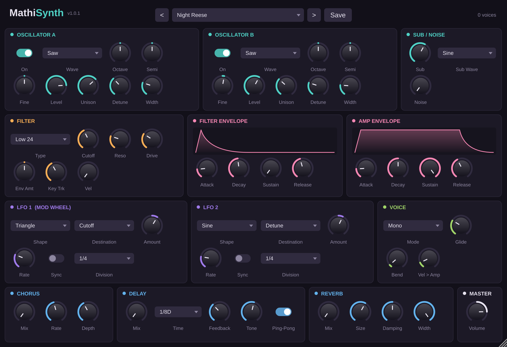

# MathiSynth

A polyphonic subtractive synth plugin (VST3, plus AU on macOS and a Standalone app) built with **JUCE 8 / C++17 / CMake**.
The engine and the 31 factory presets cover the sounds that drive dark, melodic trap and R&B beats: gliding 808s and reeses, glassy plucks, airy leads, wide pads and moving textures.



---

## 1. Stack and why

| Piece | Choice | Reason |
|---|---|---|
| Framework | **JUCE 8.0.9** (pinned, fetched by CMake) | One codebase builds VST3 for Windows and macOS. FL Studio and Ableton Live both load VST3. |
| Build | **CMake ≥ 3.22** | Generates Visual Studio, Xcode or Ninja projects; no Projucer needed. |
| DSP | Hand-written (PolyBLEP oscillators, TPT/ZDF SVF filter, custom envelopes and LFOs) plus `juce::dsp` Chorus and Reverb | Full control over the parts that define the sound (filter, glide, voice handling). The effects use proven JUCE code. |
| UI | JUCE Components + a custom `LookAndFeel` | Vector-drawn and fully scalable; no image assets to manage. |

HISE would also work, but JUCE gives you plain C++ you can version, test and extend without a separate IDE.

---

## 2. Project structure

```
MathiSynth/
├── CMakeLists.txt              Plugin target (VST3/AU/Standalone) + headless test target
├── Source/
│   ├── Parameters.h/.cpp       Every parameter ID, range, default and display format (one source of truth)
│   ├── PluginProcessor.h/.cpp  Host glue: reads params per block, tempo/transport, state save/load, host programs
│   ├── PluginEditor.h/.cpp     Window layout, preset browser, scalable UI
│   ├── dsp/
│   │   ├── DspUtils.h          PolyBLEP oscillator, ZDF state-variable filter, ADSR, LFO, RNG, saturator
│   │   ├── SynthEngine.h/.cpp  16-voice engine: allocation, mono/legato + glide, unison, filter, modulation
│   │   └── Effects.h/.cpp      Chorus → tempo-synced ping-pong delay → reverb → master + soft clip
│   ├── presets/
│   │   ├── FactoryPresets.cpp  The 31 factory presets, written as readable parameter overrides
│   │   └── PresetManager.h/.cpp Factory + user presets, save/load as XML
│   └── ui/
│       ├── MathiLookAndFeel.*  Dark theme, colour accent per section, knob/switch/menu drawing
│       └── Section.*           Titled panel that lays out knobs/menus/switches in a grid; envelope display
├── tests/RenderTest.cpp        Renders every preset offline and checks it; can export WAVs and a UI snapshot
├── scripts/                    One-shot build + install scripts for Windows / macOS / Linux
└── docs/ui.png
```

---

## 3. Sound engine (signal flow)

```
 per voice (16 voices, or 1 in Mono/Legato)
 ┌──────────────────────────────────────────────────────────────────────────────┐
 │ Osc A (1–7 unison) ┐                                                          │
 │ Osc B (1–7 unison) ┼─► Drive (tanh) ─► Filter (LP24/LP12/BP/HP) ─► Amp ─► Pan  │
 │ Sub  (−1 oct)      │          ▲ cutoff = base · env · keytrack · velocity · LFO │
 │ Noise              ┘                                                          │
 └──────────────────────────────────────────────────────────────────────────────┘
        ▼ sum
 Chorus ─► Delay (sync, ping-pong, tone) ─► Reverb ─► Master gain ─► soft clip ─► out
```

**Oscillators.** Sine, Triangle, Saw, Square and 25% Pulse. Saw and pulse use PolyBLEP to remove aliasing.
- *Unison* runs up to 7 copies per oscillator.
- *Detune* spreads them on a curve, from subtle (about ±4 cents at 20%) to wide (±1 semitone at 100%).
- *Width* pans the copies across the stereo field.
- A single voice always starts at phase 0, so 808s hit the same way every time. Unison stacks start at random phases so they sound wide straight away.

**Filter.** A zero-delay-feedback state-variable filter (Simper/Zavalishin). It stays stable when the cutoff is modulated on every sample, which fast pluck envelopes and LFO wobbles need. LP24 is a Butterworth stage feeding a resonant stage.
- *Drive* saturates before the filter, so it adds grit to basses without making resonance harsh.
- *Env Amt* moves the cutoff by up to ±7 octaves.
- *Key Trk* makes the filter follow pitch.
- *Vel* makes soft notes darker.

**Voice modes.**
- *Poly*: 16 voices with oldest-note stealing.
- *Mono*: always retriggers, and always glides when Glide > 0.
- *Legato*: overlapping notes glide **without** retriggering the envelopes. This is the classic 808 slide: overlap two notes in the piano roll and the bass bends into the second one.

Glide takes the same time whatever the interval. Mono modes get +6 dB so a single bass voice sits level with poly chords.

**Modulation.** Two LFOs (Sine, Triangle, Saw, Square, Sample & Hold), each with free rate or tempo sync (4/1 to 1/32, including triplets).
- When synced, the phase locks to the DAW's bar grid while the transport plays.
- Destinations: Cutoff, Pitch, Amp, Pan, Unison Detune, Resonance.
- Amp with a negative amount on a Saw gives a sidechain-style pump (see *Pump Chords*).
- The **mod wheel deepens LFO 1**, which suits vibrato on leads and wobble on basses.
- Pitch bend range is adjustable up to 24 semitones. Sustain pedal (CC64) is supported.

**Effects.**
- *Chorus*: JUCE Chorus.
- *Delay*: tempo-synced (1/32 to 1/2, dotted and triplet), with ping-pong. A tone filter in the feedback path ranges from dark tape to bright digital, and a 150 Hz high-pass keeps echoes from muddying the low end.
- *Reverb*: Freeverb-style.
- Each effect is skipped entirely while its Mix is 0.
- A gentle soft clipper on the output catches overs.

**Real-time safety.** The audio thread does not allocate, lock or touch parameter objects. Parameters are read once per block from atomics into a plain struct. MIDI is sample-accurate: each block is split at every MIDI event.

---

## 4. UI and workflow

Each row is a group with its own colour: **Oscillators** (teal), **Filter + Envelopes** (amber/pink), **LFOs + Voice** (violet/green), **Effects** (blue).

- **Hover or drag a knob** to see its exact value; the caption returns to the name afterwards.
- **Double-click a knob** to reset it to its default.
- Osc B's controls grey out when it's switched off.
- The envelope panels draw the current ADSR shape.
- **Preset bar:** `<` `>` step through presets. The menu is grouped by role (Bass / Pluck / Lead / Pad / Texture). **Save** writes your own preset.
- **Resizable window** (60%–200%), with the aspect ratio locked so nothing reflows.
- The presets are also exposed as host *programs*, so FL Studio's preset arrows and Ableton's program list can browse them.

User presets are saved to `Documents/MathiSynth/Presets/<Category>/<Name>.mathipreset` (readable XML) and appear in the menu under *User …*.

---

## 5. Factory presets

| Role | Presets | Starting points |
|---|---|---|
| **Bass** | Slide 808 · Distorted 808 Glide · Night Reese · Velvet Sub · Groove Pluck Bass · Wub Wobble · Rubber Bass | 808s are Legato/Mono with Glide and bend range ±12. Overlap notes for slides, and use **Drive** to make the 808 audible on phone speakers. |
| **Pluck** | Glass Bell Pluck · Midnight Pluck · Crystal Keys · Dark Mallet · Lo-Fi Harp · Arp Spark · Kalimba Drip | Zero-sustain envelopes. Shape them with **Filter Env Decay** and the dotted-1/8 **Delay**. |
| **Lead** | Silk Lead · Whistle Lead · Vapor Square · Siren Fifths · Flute Air · Hyper Saw Lead | Push the mod wheel for vibrato; glide is on for most. |
| **Pad** | Dream Pad · Warm Analog Strings · Midnight Choir · Glass Air Pad · Underwater Pad · Sunset Keys Pad | Slow attacks, wide unison, chorus and big reverb. **LFO 1 → Cutoff** keeps them moving. |
| **Texture** | Vinyl Haze · Gated Saw Texture · Night Rain · Drift Atmosphere · Pump Chords | Sample & Hold filter movement, tempo-synced gates and pumps, noise beds. |

The presets aim at the general palette of modern melodic trap and R&B production. They are not copies of any particular producer's patches, so treat them as starting points and tweak by ear against your references. To change or add one, edit `Source/presets/FactoryPresets.cpp`. Each preset is a list of `{ paramID, value }` overrides in real units, applied on top of the defaults.

---

## Download (no compiling needed)

Ready-made builds are on the **[Releases page](https://github.com/mathistheisen-wq/MathiSynth/releases/latest)**:

| File | For | How to install |
|---|---|---|
| `MathiSynth-Windows.zip` | Windows: FL Studio, Ableton | Unzip it and copy the `MathiSynth.vst3` folder to `C:\Program Files\Common Files\VST3\`. Then rescan plugins. |
| `MathiSynth-macOS-Installer.pkg` | Mac (Apple Silicon and Intel): FL Studio, Ableton, Logic | macOS warns that it "could not verify" the installer, because it isn't Apple-signed yet. Follow the **[Mac install guide](docs/MAC_INSTALL.md)**: click *Open Anyway* in System Settings → Privacy & Security, then run the installer. |
| `MathiSynth-macOS.zip` | Mac, manual install | See *"I'd rather install by hand"* in the [Mac install guide](docs/MAC_INSTALL.md). |

GitHub Actions rebuilds these files on every push to `main`.

**Mac users:** read the step-by-step **[Mac install guide](docs/MAC_INSTALL.md)**. It covers the security warning, setup in FL Studio, Ableton and Logic, troubleshooting, updating and uninstalling.

## 6. Build and install

All platforms need **CMake 3.22+** and **Git**. The first configure downloads JUCE (about 150 MB). To use a JUCE checkout you already have, pass `-DJUCE_DIR=/path/to/JUCE`.

### Windows (for FL Studio and Ableton Live)
1. Install **Visual Studio 2022 or newer** with the *Desktop development with C++* workload.
2. Open *x64 Native Tools Command Prompt for VS* **as Administrator**, then:
   ```bat
   scripts\build-windows.bat
   ```
   This builds Release and copies `MathiSynth.vst3` to `C:\Program Files\Common Files\VST3\`.

   To build by hand instead:
   ```bat
   cmake -B build -A x64
   cmake --build build --config Release --target MathiSynth_VST3
   ```
   The output is `build\MathiSynth_artefacts\Release\VST3\MathiSynth.vst3`.

### macOS (for Ableton Live and FL Studio for Mac)
1. Install **Xcode** (plus `xcode-select --install`) and CMake (`brew install cmake`).
2. Run:
   ```bash
   ./scripts/build-macos.sh
   ```
   This builds a universal (Apple Silicon + Intel) VST3 and AU and installs them to `~/Library/Audio/Plug-Ins/`.

### Linux / CI
```bash
./scripts/build-linux.sh
```
This builds everything and runs the render test.

---

## 7. Testing in your DAWs

**FL Studio**
1. *Options → Manage plugins → Find installed plugins* (make sure the VST3 folder is in the search paths).
2. Star **MathiSynth** so it shows in the plugin picker. Add it to a Channel Rack slot.
3. Use the preset arrows in MathiSynth's header (or FL's own) to audition.
4. For 808 slides in FL, either set the voice mode to *Legato* and overlap notes, or use FL's slide notes.

**Ableton Live**
1. *Settings → Plug-Ins →* enable **Use VST3 Plug-In System Folders**, then **Rescan**.
2. Find MathiSynth under *Plug-Ins → VST3 → Mathi Audio*. Drag it to a MIDI track.
3. Click *Configure* in the device header to expose parameters for automation and Push.

**Quick checks before using it in a session**
- The **Standalone** app (`build/.../Standalone/`) lets you play it without a DAW.
- Run the offline test. It renders every preset and checks for NaN, silence, clipping and state save/restore:
  ```bash
  ./build/MathiSynthTests_artefacts/Release/MathiSynthTests              # pass/fail table
  ./build/MathiSynthTests_artefacts/Release/MathiSynthTests --wav renders # one WAV per preset
  ```
  On Windows the test executable is under `build\MathiSynthTests_artefacts\Release\`.
- Optionally run [pluginval](https://github.com/Tracktion/pluginval) at strictness 5 or higher on the built `.vst3`. It catches most host-compatibility problems before FL or Ableton do.

**Troubleshooting**
- *Plugin not found:* check that the `.vst3` is in the system VST3 folder, then rescan. On macOS, the script already clears the quarantine flag.
- *Windows "missing DLL":* the build links the MSVC runtime statically, so this shouldn't happen. Rebuild in Release, not Debug.
- *Distribution:* for anything beyond your own machine, sign the plugin. On macOS that means codesign and notarize.

---

## 8. Extending

- **New parameter:** add an ID in `Parameters.h`, create it in `Parameters.cpp`, read it in `PluginProcessor::readParameters`, use it in the DSP, and add one line in `PluginEditor.cpp` (`section->addKnob(id, "Label", row)`).
- **New LFO destination:** add it to `Choices::lfoDests` and the `LfoDest` enum, then read `lfoBuf[dest]` in `SynthEngine::renderVoice`.
- **Ideas:** a wavetable oscillator, a mod matrix, an oversampled drive, and an arpeggiator (an `AudioProcessor` MIDI pre-pass).
